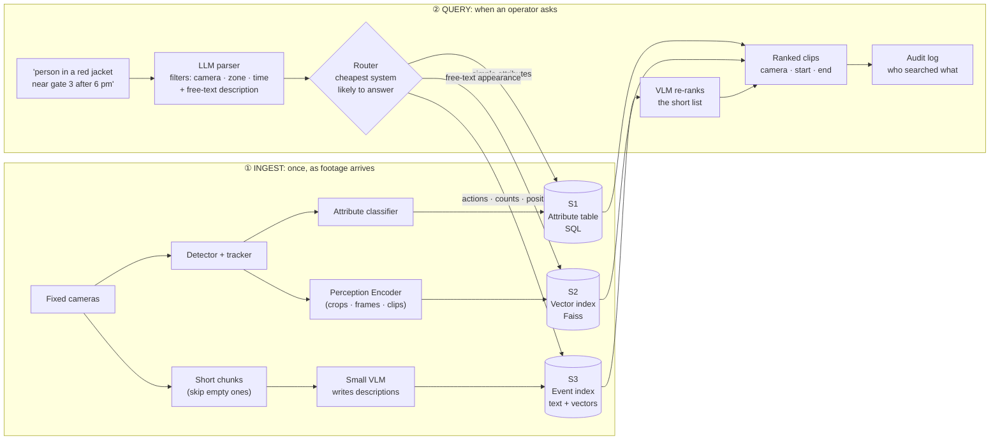

# Finding footage by description

**Master's thesis: attribute indexes, image–text embeddings and video–language models for natural-language video search over fixed-camera archives.**

> **Research question:** Which approach, or which combination, answers natural-language queries over fixed-camera archives accurately enough, at acceptable cost and speed, as the archive grows from days to months of footage?

Reading notes for all the papers are in [`docs/`](docs/README.md).

---

## 1. The idea in one picture

There are two moments: **ingest** (footage is processed once, as it arrives, and stored in three indexes) and **query** (an operator asks a question and the router picks which index to search).



| | S1: Attribute index | S2: Embedding index | S3: VLM event index |
|---|---|---|---|
| **Stores** | A fixed list of facts per tracked object | One vector per crop, frame or clip | A text description per event |
| **Good at** | Fast and exact filters (colour, bag, vehicle type) | Any wording, appearance | Actions, counting, positions, detail |
| **Weak at** | Anything not on the list | Counting, positions, fine colour | Cost and speed |
| **Cost** | Low | Medium | High |

All three systems share the same **front end** (query parsing into hard filters + free text) and the same **output unit** (a clip: `camera, t_start, t_end`, optionally a bounding box). That makes them directly comparable and lets them be combined.

---

## 2. Plan of work

This is a rough timeline for about 6 months. The dates will be adjusted to the internship calendar, and the scope to the data Whiteshield can provide (see section 3).

### Phase 0: Setup and framing (weeks 1–3)
- Literature review: done. The reading notes are in [`docs/`](docs/README.md). Next, turn them into the outline of the related-work chapter.
- Talk to the people who search footage today, to understand how they work and to **collect real queries** they've asked after past incidents (anonymised). This is the most valuable input to the whole thesis.
- Agree on the data access framework with Whiteshield: data protection assessment, retention rules, where data may be processed (see [docs/06](docs/06_privacy_and_eu_ai_act.md)).
- Get access to footage, metadata and compute. Set up the environment and storage layout.
- Build a small **development set on public data** (VIRAT / MEVA / UCF-Crime + UCA), so work can start before Whiteshield data is available.

### Phase 1: Test set (objective 1, weeks 3–8)
- Select a **core subset** of footage that is as varied as possible in scenes (entrances, parking, loading areas, indoor) and lighting (day, night, infrared). Its size depends on what is available, for example 10–20 cameras over 3–7 days.
- Write **200–400 queries** from three sources:
  - real operator queries (paraphrased);
  - queries written while watching the footage;
  - targeted queries for each failure type.
- Tag each query with **categories** (a query can have several):
  `attribute-colour`, `attribute-object` (bag, helmet…), `vehicle-type`, `action`, `count`, `spatial-relation`, `place/zone`, `time`, `rare-word`, `negation`, `multi-entity`.
- **Paraphrase sets**: 3–5 phrasings per query (some written by people, some by an LLM in different styles, following the idea in [docs/02](docs/02_ham_text_to_person_reid.md)), to test robustness to wording.
- **Relevance labels**, done by **pooling** (as in TREC):
  1. run early versions of the three systems, with time and camera filters;
  2. collect all their top-k results together;
  3. annotators judge each candidate as relevant, partly relevant or not relevant;
  4. add known positives found by hand (from incident reports or manual review), to catch what all systems missed.
- Ground-truth unit: a time interval on a camera, optionally with a bounding box. A returned clip counts as a hit if it overlaps a relevant interval enough. The threshold is to be fixed, for example temporal IoU ≥ 0.3, or "contains the moment".
- Write an annotation guide and measure **inter-annotator agreement** on a sample (Cohen's κ).
- Split the queries into a **dev** set for tuning (~30%) and a **test** set that stays untouched (~70%).

### Phase 2: Build the three systems (objective 2, weeks 6–14)

**Shared pipeline**
- Decode video at a fixed sampling rate (e.g. 1–2 fps for indexing).
- Detector + tracker: reuse Whiteshield's existing detector if there is one, otherwise YOLO + ByteTrack. Output: tracks with `camera, track_id, class, t_start, t_end, boxes`.
- Query parser: an LLM turns the query into JSON `{cameras/zones, time range, object class, attributes, free_text}`. Its parse accuracy is evaluated separately.
- Blur faces on stored crops.

**S1: Structured attribute index**
- Fix the attribute schema, starting from PA-100K / RAP plus vehicle colour and type, and leaving out sensitive traits.
- Compute attributes for each track, either with a PAR classifier on the best crops or with a VLM filling a fixed JSON form (compare both if time allows).
- Store them in a relational database. A query becomes an SQL filter, ranked by attribute confidence.

**S2: Image–text embedding index**
- Backbone: **PE Core** (B and L, possibly G), plus one alternative (SigLIP 2) for comparison.
- Three granularities: **track crops** (best K crops per track), **whole frames**, **short clips** (frame-averaged).
- Faiss: `Flat` (exact search, used as reference), then `IVF`, `HNSW`, `IVF-PQ`. Time and camera filters through per-shard indexes or `IDSelector`.
- Fuse scores when several granularities are combined.

**S3: Video–language event index (AVA-style)**
- Ingest: cut footage into chunks of a few seconds and skip empty ones (gated by motion or detections). A small VLM (e.g. Qwen2.5-VL-7B or newer) describes each chunk. Similar consecutive chunks are merged into events, and each event's text, text embedding and frame embedding are stored.
- Query: retrieve the top-N events (text and frame embeddings plus filters), then **re-rank and verify** them with a VLM that looks at the actual frames.
- Optional: agentic search (moving forward and backward in time, rewriting the query) as in AVA, measuring whether it is worth its cost.

### Phase 3: Evaluation at several archive sizes (objective 3, weeks 12–18)
- **Archive sizes**: 1 day, 1 week, 1 month, and longer if retention and storage allow. The relevant clips stay the same while **distractor footage** is added to grow the archive. This isolates the effect of scale.
- **Metrics**:
  - Accuracy: Recall@1/5/10/50, mAP, and recall per query category.
  - Speed: query latency p50 / p95, split into parsing, retrieval and re-ranking.
  - Ingest cost: **GPU-seconds per hour of footage** per camera, and throughput as a real-time factor.
  - Query cost: GPU-seconds (or €) per query.
  - Storage: bytes per hour of footage (database, vectors, text).
  - Faiss: ANN recall vs exact search, memory, build time.
- Convert GPU time into € using one fixed price per GPU-hour, stated as an assumption.
- Plot **accuracy vs cost** and **accuracy vs archive size** for each system and each combination.
- Combinations to test:
  - S1 filter, then S2 ranking;
  - S2 short list, then S3 re-rank;
  - S1 ∪ S2, then S3.

### Phase 4: Failure analysis and router (objective 4, weeks 16–21)
- Break recall down by query category × system, giving a table of **which system fails on what** (colour, counting, positions, rare words, night/IR, small or distant objects).
- Analyse failures qualitatively, with example frames (faces blurred).
- **Router**: given a parsed query, choose the cheapest system likely to answer it. Options, from simple to advanced:
  1. **Rule-based**, e.g. "only schema attributes + filters → S1; free-text appearance → S2; actions, counts, relations → S2 + S3 re-rank".
  2. **Learned**: a small classifier on query features (categories, parse output, S2 score distribution), trained on dev-set outcomes.
  3. **Cascade**: try the cheapest system first and move up when confidence is low (as in FrugalGPT / Focus).
- Evaluate the router on the test set: accuracy vs average cost, compared with "always S1 / S2 / S3" and with an **oracle** router (upper bound).

### Phase 5: Writing (weeks 20–26)
- Chapters: Introduction, Related work, Setting and test set, Systems, Results, Failure analysis and router, Ethics and privacy, Conclusion.
- Optional extension: **Arabic queries**. Translate a subset of the test set and evaluate each system on it (PE text encoder, multilingual LLM parser, VLM). The simple baseline is translating the query to English first.

---

## 3. Data


### 3.1 Starting assumptions (to be confirmed or corrected)
- **A1.** Footage comes from **fixed RGB cameras** (no moving PTZ cameras) at one or more sites, including at least some outdoor views and some night footage.
- **A2.** Footage can be exported as standard video files (e.g. MP4/H.264) with a **reliable timestamp** and a **camera identifier**.
- **A3.** There is **no face recognition** and no identification of named people (out of scope, see [docs/06](docs/06_privacy_and_eu_ai_act.md)).


If footage arrives late or turns out to be limited, development continues on public fixed-camera datasets (**VIRAT, MEVA, UCF-Crime + UCA, CityFlow-NL**, see [docs/05](docs/05_other_relevant_work.md#d-datasets-with-fixed-cameras-to-develop-before-whiteshield-data-arrives-and-for-public-reproducibility)), and the Whiteshield data is used for the final evaluation.

### 3.2 Footage
1. What kind of sites and scenes do the cameras cover (entrances, car parks, loading areas, indoor spaces…)?
2. How many cameras could be included, and how many hours or days of footage are available per camera?
3. What format is it in (codec, resolution, frame rate), and how is it exported (VMS/NVR export, files, stream)?
4. Is recording continuous or triggered by motion? Are there known gaps?
5. Are there night or infrared cameras? Any moving (PTZ) cameras?

### 3.3 Metadata and existing tools
7. Is there a camera list with identifiers and human-readable names ("Gate 3")?
8. Is there a site map, or a mapping from cameras to named zones (gate, loading bay, car park)? This is needed for queries like "near gate 3".
9. Are timestamps reliable and synchronised across cameras? Which time zone?
10. Is a detector or video-analytics system already running (e.g. person / vehicle events)? If so, can its outputs be used as a baseline?

### 3.5 Compute and infrastructure
16. Which GPUs are available (type, number, memory), and for how long?
17. How much storage is available for footage, indexes and embeddings?
18. Are any external or cloud services allowed for non-footage data (e.g. an LLM for parsing query text only), or must everything be local?
19. Is there an internal reference cost per GPU-hour, to express cost results in €?

### 3.6 Legal, privacy and sharing
20. What framework applies to using the footage for research (data protection assessment, access agreement, who may view raw video)?
21. What may appear in the thesis and in this repository (aggregate results, blurred frames, query texts)?
22. Could an anonymised version of the query set be published with the thesis, or must it stay internal?

### 3.7 Scope decisions to take together
24. What should the **unit of an answer** be: a tracked object, a fixed-length clip, or an event? It affects every metric.
25. What is an "acceptable" answer time and cost per query from an operator's point of view? This sets the target for the router.

---

## 4. Expected contributions

1. A **fixed-camera natural-language search benchmark**: queries tagged by category, paraphrase sets, pooled relevance labels, at several archive sizes.
2. A **like-for-like comparison** of attribute index vs embedding index vs VLM event index on **accuracy, latency, ingest cost and query cost**, as the archive grows.
3. A **failure taxonomy**: which query types break which approach.
4. A **cost-aware router** that sends each query to the cheapest approach likely to answer it, measured against an oracle.
5. A **privacy-by-design** argument: appearance and context search without biometric identification, with audit logging.

---

## 5. Proposed repo layout

```
thesis-video-search/
├── README.md              ← this plan
├── docs/                  ← reading notes
├── data/                  ← (git-ignored) footage pointers, metadata, never raw video in git
├── benchmark/             ← queries, categories, paraphrases, relevance labels, annotation guide
├── src/
│   ├── common/            ← decoding, detection, tracking, query parser, clip format, audit log
│   ├── s1_attributes/
│   ├── s2_embeddings/
│   ├── s3_vlm_events/
│   ├── router/
│   └── eval/              ← metrics, cost accounting, archive-size scaling
├── experiments/           ← configs + result logs
└── thesis/                ← LaTeX manuscript
```
